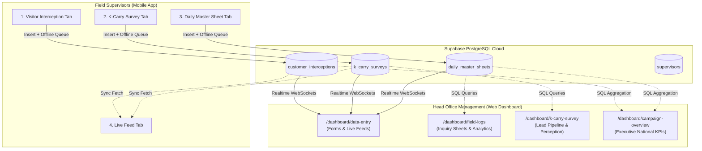

# Pak Suzuki Express 2026 • Full-Cycle Data Flow Integration Plan

This plan outlines the systematic implementation of real-time database connectivity, bidirectional sync, and offline persistence connecting the **React Native Mobile App** and the **Next.js Web Dashboard** via **Supabase PostgreSQL**.

---

## Architecture Overview

---

## What Is Already Completed (Foundation)

- [x] **Supabase Project Active:** `https://svvkckmuuleaysqmcwea.supabase.co`
- [x] **Database Schema Deployed:** Created 4 core tables via `psql`:
	- `supervisors` (seeded with `admin@paksuzuki.com.pk` and `gohar.ali@suzuki.com.pk`)
	- `customer_interceptions` (indexes on city and timestamp)
	- `k_carry_surveys` (indexes on city, lead_status, created_at)
	- `daily_master_sheets` (JSONB for 7x7 matrix, indexes on city, date)
- [x] **Realtime Publications Active:** `ALTER PUBLICATION supabase_realtime ADD TABLE ...` applied for instant WebSocket broadcast.
- [x] **Nightly Automated Backups:** `.github/workflows/daily-backup.yml` running `pg_dump` daily at 2:00 AM PKT (stored as private 90-day GitHub artifacts).
- [x] **Web & Mobile Supabase Clients:** `@supabase/supabase-js` configured with environment keys on both web and mobile.
- [x] **Web Interception Live Integration:** `customer-interception-form.tsx` connected to Supabase with WebSocket subscriptions.

---

## Phase 1: Web Data Entry Forms Integration

### 1.1 K-Carry Survey Form (`k-carry-survey-form.tsx`)
- **Goal:** Allow desktop/laptop operators to enter 10-question K-Carry surveys and save them directly to Supabase.
- **Actions:**
	- Import `supabase` from `@/lib/supabase`.
	- Connect `handleSubmit()` to insert a new row into `k_carry_surveys`.
	- Add toast confirmation on successful insert with error handling.

### 1.2 Daily Master Inquiry Sheet Form (`daily-inquiry-sheet-form.tsx`)
- **Goal:** Allow operators to submit caravan day-end station audits with full 4W matrix numbers to Supabase.
- **Actions:**
	- Connect `handleSubmit()` to insert a new row into `daily_master_sheets`.
	- Save `fourWheelData` (7 models × 7 metrics) as structured `JSONB`.
	- Save aftersales stats: `free_inspections`, `free_oil_changes`, `appointments_given`, and `genuine_parts_revenue_pkr`.

---

## Phase 2: Web Analytics & Reporting Pages Integration (Completed)

- [x] **Field Logs Page (`/dashboard/field-logs`):**
  - Updated `field-logs-client.tsx`, `field-logs-summary.tsx`, `field-logs-table.tsx`, and `inquiry-analytics-charts.tsx` to read live audit entries from Supabase `daily_master_sheets`.
  - Dynamic footfall, test drive, free checkup, and parts revenue counters computed from live records.
  - Subscribed to Realtime WebSockets on `daily_master_sheets`.

- [x] **K-Carry Survey Intelligence Page (`/dashboard/k-carry-survey`):**
  - Updated `survey-kpi-strip.tsx`, `utility-needs-charts.tsx`, and `k-carry-perception-charts.tsx` to compute live survey response totals, % hot leads, replacement endorsement, and price tolerance from Supabase `k_carry_surveys`.
  - Connected `leads-pipeline-table.tsx` to live database records with Realtime updates.

- [x] **Campaign Overview Page (`/dashboard/campaign-overview`):**
  - Updated `kpi-strip.tsx` to sum live nationwide footfall, test drives, and checkups from `daily_master_sheets`.
  - Updated `traffic-sources.tsx` to compute regional volume shares from Supabase.
  - Updated `tour-progress-strip.tsx` to dynamically mark tour cities completed as caravan master sheets arrive.

---

## Phase 3: Mobile Offline-First & Feed Synchronization

### 3.1 Mobile Feed Tab Live Fetch (`FeedTab.tsx`)
- **Goal:** Allow field staff to see both their local logs and other tour stops' records synced from Supabase.
- **Actions:**
	- Fetch latest 30 interceptions and surveys from Supabase on tab focus.
	- Merge local pending records with cloud-confirmed records (clean de-duplication via `client_id`).

### 3.2 Mobile Auto-Sync on Network Reconnect
- **Goal:** When phone WiFi/4G drops and later reconnects, automatically flush the pending queue with zero user intervention.
- **Actions:**
	- Store unconfirmed records in mobile state/AsyncStorage with `synced: false`.
	- Listen for network restoration and batch-insert any pending items to Supabase.
	- Flip their status to `synced: true` with an emerald badge update.

---

## Phase 4: Supervisor User Management & Mobile Authentication (Completed)

- [x] **Database Schema Updated:** Added `password` column (`NOT NULL DEFAULT 'paksuzuki2026'`) to `public.supervisors`.
- [x] **Web Dashboard (`/dashboard/users`):**
  - Connected table directly to Supabase `supervisors` table.
  - Added live WebSocket real-time updates for auto-refresh when supervisors are added, updated, or removed.
  - Implemented "+ Add Supervisor" modal with full validation: Name, Email, Password, Employee ID, Role, City, Dealer, Venue, and Region.
  - Added Activate/Deactivate status toggle, Mobile login credentials copy, and CSV directory export.
- [x] **Mobile App (`LoginScreen.tsx` & `AppContext.tsx`):**
  - Updated `login()` to verify credentials against Supabase `supervisors` table in real time.
  - Checks `is_active` status and rejects deactivated accounts with an alert.
  - Loads supervisor profile (assigned city, dealer, venue, employee ID) and pre-populates all mobile forms.
  - Retained offline emergency fallback for master admin credentials (`admin@paksuzuki.com.pk`).
  - Added loading indicator and error toast feedback to `LoginScreen`.

1. **Step 1:** Wire `k-carry-survey-form.tsx` (Web Survey Insert)
2. **Step 2:** Wire `daily-inquiry-sheet-form.tsx` (Web Master Sheet Insert)
3. **Step 3:** Wire `Field Logs Page` (Live Master Sheet Table & Charts)
4. **Step 4:** Wire `K-Carry Survey Page` (Live Lead Pipeline & Metrics)
5. **Step 5:** Wire `Campaign Overview Page` (Nationwide KPI Aggregations)
6. **Step 6:** Wire Mobile Feed & Auto-Sync Refresh

