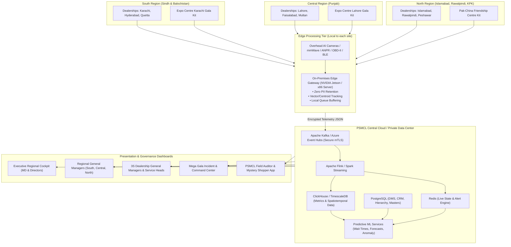

# Pak Suzuki Motor Company Ltd (PSMCL)
## Centralized Operational Intelligence & Regional Benchmarking System
### Architectural Blueprint, Feature Specification, and Implementation Roadmap

---

## 1. Executive Summary & Vision

Pak Suzuki Motor Company Ltd (PSMCL) is the market leader in Pakistan's automotive sector with an expansive manufacturing base in Bin Qasim, Karachi, and an authorized network of over 150+ 3S (Sales, Service, Spare Parts) dealerships spanning the **South**, **Central**, and **North** regions. Additionally, PSMCL conducts high-traffic public mega-events including **Certified Used Car Galas**, **New Vehicle Launch Expos**, and **Family Festivals** at national convention hubs (Expo Centre Karachi, Expo Centre Lahore, Pak-China Friendship Centre Islamabad).

To maintain market dominance, elevate customer experience, optimize workshop throughput, and establish data-driven accountability across dealerships, PSMCL requires a **Centralized Operational Intelligence System ("PSMCL OpsPulse / Astraea")**.

### Core Pillars
```
┌────────────────────────────────────────────────────────────────────────────────────────┐
│                        PSMCL CENTRAL OPERATIONAL INTELLIGENCE                          │
├──────────────────────────┬─────────────────────────────┬───────────────────────────────┤
│    3S Dealership Edge    │     Mega Gala Fly-Away      │      HQ Executive Cockpit     │
│   • Showroom Footfall    │     • Gate Velocity         │      • Regional Benchmarking  │
│   • Dwell Time / Heatmap │     • Hall Crowd Density    │      • Conversion Funnel      │
│   • Consultant Latency   │     • 130-Pt Inspection SLA │      • Service Workshop SLAs  │
│   • Test Drive Telemetry │     • Instant Booking Board │      • Network Quartile Rank  │
│   • Workshop Bay ANPR    │     • Fast-Track Lead Gen   │      • Predictive Staffing    │
└──────────────────────────┴─────────────────────────────┴───────────────────────────────┘
```

---

## 2. System Architecture & Topology

The platform utilizes a **hybrid Edge-Cloud architecture** ensuring real-time operational reactivity at local facilities and ultra-low bandwidth consumption, with aggregate telemetry streaming into PSMCL Central Cloud.



---

## 3. Detailed Operational Modules

### Module 1: Privacy-Preserving Showroom Intelligence
**Problem Statement:** Dealerships traditionally record footfall manually at reception, leading to up to 40% under-reporting, no visibility into floor customer journeys, and zero dwell time analytics for specific vehicle models (e.g., Alto VXR vs. Swift GLX CVT vs. Every/Bolan).

#### Architectural Specifications:
- **Sensor Modality:** Overhead ceiling-mounted wide-angle optical sensors and directional mmWave radar detectors.
- **Edge Inference Model:** Fine-tuned YOLOv11 person-detection pipeline compiled via TensorRT running on local edge gateway.
- **Privacy by Design (PECA 2016 Compliant):**
  - No facial recognition, gender identification, or biometric storage.
  - Video streams are processed purely in volatile RAM and immediately discarded.
  - People are abstracted into anonymous bounding centroids: `{"tracker_id": 8492, "x": 142.5, "y": 88.2, "timestamp_ms": 1740000000}`.
- **Spatial Zoning:**
  - **Zone A (Entry & Reception):** Gate footfall count, entry velocity, triage waiting zone.
  - **Zone B (Flagship Display):** Swift, Cultus, Jimny high-interest areas.
  - **Zone C (Mass Market / Commercial):** Alto, Every, Ravi display areas.
  - **Zone D (Customer Lounge & Accessories):** Suzuki Genuine Parts (SGP) and Genuine Oil (SGO) display counter.
  - **Zone E (Consultation Desks):** Sales consultant negotiation cubicles.

#### Key Metrics & Output Data:
- Real-time Showroom Occupancy vs. Maximum Safe Capacity.
- Vehicle Engagement Index (VEI): Touch duration, door opening frequency, and driver's seat dwell time.
- Passerby-to-Showroom Entry Conversion Rate.

---

### Module 2: Sales Consultant Productivity & Customer Journey Tracking
**Problem Statement:** Long unaddressed customer waiting times directly correlate with lost bookings. Management lacks visibility into how promptly walk-ins are greeted and how sales consultations progress.

#### Architectural Specifications:
- **Staff Proximity & Badge Telemetry:** Anonymized BLE beacon badges issued to authorized sales consultants. Micro-receivers located at consultation desks track consultant presence.
- **Computer Vision Desk Triage:** Overhead cameras measure occupancy states of consultant desks:
  - *State 1 (Empty):* Consultant away.
  - *State 2 (Consultant Only):* Consultant ready / administrative task.
  - *State 3 (Active Consultation):* Consultant + Customer present.
- **Integration with Pak Suzuki DMS (Dealer Management System):**
  - Correlates physical desk dwell time with electronic Lead Creation / Quotation generation timestamps.

#### Key Metrics & Output Data:
- **Greeting Latency:** Seconds elapsed between customer entry into Zone A and initial sales interaction.
- **Average Wait Time (AWT):** Customer wait duration in reception before being seated with a consultant.
- **Consultation Duration (CD):** Average consultation time per prospect (benchmark: 22–35 minutes for high-intent buyers).
- **Consultant Utilization Rate:** % of working hours spent in verified customer-facing dialogue vs. idle.
- **Walkout Rate:** Prospects who abandon showroom after waiting > 12 minutes without engagement.

---

### Module 3: Test Drive Dispatch, Telemetry & Route Analytics
**Problem Statement:** Test drives are the highest-converting touchpoint, yet dealerships often suffer from low test drive utilization, off-route deviations, vehicle misuse, and inadequate post-drive follow-up.

#### Architectural Specifications:
- **Digital Check-In & e-KYC:** Receptionist scans customer CNIC (Computerized National Identity Card) barcode and driving license using a dedicated tablet app; digital terms & conditions signed.
- **Vehicle Telemetry (OBD-II + 4G GPS):**
  - Real-time geofence monitoring of pre-approved test drive corridors (e.g., Karachi Shahrah-e-Faisal loop, Lahore Gulberg-Main Boulevard loop, Islamabad Blue Area corridor).
  - Telemetry parameters: Vehicle ignition status, speed, hard acceleration, hard braking, route deviations, and total route duration.
- **Conversion Attribution Pipeline:**
  - Connects test-drive record directly to chassis booking records in the central sales database.

#### Key Metrics & Output Data:
- Test Drive Dispatch Velocity (dispatches per vehicle per day).
- Route Completion Time (ideal target: 15–20 mins).
- Route Compliance Score (% of drives adhering strictly to the geofenced corridor).
- **Test-Drive-to-Booking Conversion Rate** (benchmarked regionally and per model).

---

### Module 4: 3S Service Bay & Aftersales Workshop Throughput
**Problem Statement:** Service and spare parts generate vital dealership margins. Long vehicle turnaround times, slow job card creation, and bay bottlenecks lead to customer dissatisfaction and under-utilized mechanic capacity.

#### Architectural Specifications:
- **Gate ANPR (Automatic Number Plate Recognition):**
  - High-speed LPR cameras at workshop entry & exit lanes.
  - Custom trained on Pakistani provincial license plate formats (Sindh, Punjab, Islamabad Capital Territory, Balochistan, KPK).
  - Instantly checks chassis history, warranty status, and service intervals upon vehicle roll-in.
- **Digital Reception & Service Advisor Triage:**
  - Tracks time taken from vehicle arrival at gate to Service Advisor job card generation on tablet.
- **Bay Activity Optical Telemetry:**
  - Wide-angle bay sensors monitor Periodic Maintenance (PMS) bays, Express Maintenance bays, Mechanical repair bays, and Wheel Alignment bays.
  - Detection states: Bay Occupied (Vehicle Present), Technician Active (Movement detected near hood/undercarriage), Bay Idle, Waiting for Spare Parts, Quality Inspection.
- **Spare Parts Requisition Latency:**
  - Integrates with Suzuki Genuine Parts (SGP) inventory counter to track delay between job card parts request and delivery to mechanic bay.

#### Key Metrics & Output Data:
- **Gate-to-Advisor Handshake Time:** Target < 7 minutes.
- **Express Bay Turnaround Time (TAT):** Target < 45 minutes for standard oil and filter periodic service.
- **Bay Utilization Efficiency (%):** Active repair hours divided by total available bay operating hours.
- **First-Time-Right (FTR) Index:** Proportion of vehicles serviced without return claims within 30 days.

---

### Module 5: Mega Galas & Expo Center Pop-Up Intelligence
**Problem Statement:** Events like the **Pak Suzuki Certified Used Car Gala** at Expo Centre Karachi or Expo Centre Lahore draw 30,000+ visitors over a weekend. Operations suffer from unmanaged entrance queues, hall overcrowding, slow 130-point car inspections, and lack of live transaction analytics.

#### Architectural Specifications:
- **Rapid-Deployment Fly-Away Kits:**
  - Ruggedized pelican cases containing: Edge Gateway server, 6x tripod-mountable PoE 3D LiDAR / stereoscopic cameras, industrial Wi-Fi 6 APs, and multi-SIM 5G / Starlink bonded cellular failover routers.
- **Entrance Velocity & Ticket Validation:**
  - Optical turnstile overhead counters + QR scan validators measuring check-in throughput (visitors/minute per turnstile gate).
- **Arena Crowd Density Heatmaps:**
  - Real-time heat mapping across Hall 1, Hall 2, Hall 3, and outdoor vehicle display staging grounds.
  - Automatic notification when hall occupant density exceeds 1.8 persons/m² (NFPA life-safety threshold).
- **130-Point Certified Used Car Inspection Telemetry:**
  - Digital inspection lane monitoring: Used vehicles queued, undergoing digital paint depth analysis, engine OBD diagnostic scan, and hoist inspection.
  - Digital staging clock measuring throughput time per car (Target: 18 mins per inspection).
- **Live Event Auction / Booking Board:**
  - Displays live booking tickers on mega-screens, generating buyer excitement while feeding back live booking counts to HQ command.

#### Key Metrics & Output Data:
- Real-Time Live Attendees inside Venue vs. Total Daily Footfall.
- Peak Gate Choke-Point Analysis (arrival velocity by hour).
- 130-Point Inspection Throughput (cars certified/hour).
- Certified Car Sales Velocity (cars sold per hour, average time on display before booking).

---

### Module 6: Executive Regional Benchmarking Engine
**Problem Statement:** Top management at PSMCL Headquarters (Bin Qasim) requires normalized, objective performance comparisons across disparate operating regions without subjective dealer reporting bias.

#### Regional Categorization:
| Region | Core Hubs | Territory Characteristics |
| :--- | :--- | :--- |
| **South Region** | Karachi, Hyderabad, Sukkur, Quetta, Gwadar | High commercial volume, port proximity, heavy Every/Bolan demand, large multi-bay urban 3S facilities. |
| **Central Region** | Lahore, Faisalabad, Gujranwala, Multan, Sialkot | Dense retail private buyer market, high demand for Swift/Cultus/Alto, massive Certified Used Car Gala attendance. |
| **North Region** | Islamabad, Rawalpindi, Peshawar, Abbottabad, Mirpur | High government/corporate fleet volume, demanding terrains (AWD/Jimny preference), distinct seasonal footfall trends. |

#### Regional Comparison Matrix & KPIs:
1. **Normalized Footfall-to-Booking Ratio:**
   $$\text{Conversion Efficiency} = \frac{\text{Confirmed Bookings}}{\text{Qualified Showroom Footfall}} \times 100$$
2. **Consultant Performance Index (CPI):** Normalized score based on greeting speed, quotation-to-visit ratio, and test-drive completion rate.
3. **Workshop Labor Productivity Index (WLPI):**
   $$\text{WLPI} = \frac{\text{Billed Labor Hours}}{\text{Clocked Technician Hours}} \times 100$$
4. **Dealership Quartile Classification:**
   - **Tier 1 (Platinum - Top 25%):** Conversion > 14%, Wait Time < 6m, Bay Utilization > 85%.
   - **Tier 2 (Gold - Next 25%):** Conversion 10-14%, Wait Time 6-10m, Bay Utilization 75-85%.
   - **Tier 3 (Silver - Next 25%):** Conversion 7-10%, Wait Time 10-15m, Bay Utilization 60-75%.
   - **Tier 4 (Bronze - Bottom 25%):** Immediate operational audit & HQ intervention required.

---

## 4. Innovative Value-Added Suggestions & Features

Beyond the core requirements, the following cutting-edge capabilities will make the PSMCL platform an industry benchmark in South Asia:

### 1. AI-Driven Dynamic Showroom Totems (Contextual Digital Signage)
- **Concept:** When a customer's dwell time in front of a specific vehicle (e.g., Alto VXL AGS or Swift GLX) exceeds **90 seconds**, the adjacent interactive 55" 4K display automatically switches from generic loop branding to the exact vehicle's trim comparison, financing calculator (Meezan Bank, Bank Alfalah auto-loan plans), fuel economy metrics, and immediate test drive booking QR code.

### 2. Predictive Staffing & Shift Optimizer
- **Concept:** Uses historical timeseries data, payday schedules, local festival calendars (Eid shopping surges, tax year-end in June), and weather forecasts to predict footfall spikes 7 days in advance.
- **Action:** Generates recommended consultant duty rosters and service technician bay assignments to prevent weekend bottlenecks.

### 3. Automated Mystery Shopper & Customer Experience Index (CEI)
- **Concept:** Eliminate costly and subjective third-party mystery shopping audits.
- **Calculation:** An algorithm automatically computes a continuous daily CEI (0–100) per dealership based on:
  - Greeting latency (< 3 mins = 100%, > 10 mins = 0%).
  - Test drive availability on demand.
  - Customer lounge dwell experience (tea/water service delay).
  - Workshop delivery punctuality against promised job card completion time.

### 4. Vehicle Display Battery & Showroom Fleet Health Telemetry
- **Concept:** Showroom display cars have doors, ignitions, and infotainment systems operated hundreds of times a day by visitors, frequently causing dead 12V auxiliary batteries.
- **Feature:** Wireless mini-voltage sensors on display cars trigger real-time alerts to the dealership admin before a customer experiences a dead battery when trying out a vehicle.

### 5. Gala "VIP Fast-Track" Instant WhatsApp Concierge
- **Concept:** At busy mega-galas (Expo Centre Karachi/Lahore), high-intent visitors who scan vehicle window QR codes receive an automated WhatsApp interactive bot.
- **Feature:** If the visitor requests an on-the-spot bank lease pre-approval or certified car inspection report, the system assigns a dedicated sales consultant within 2 minutes via SMS push with the customer's exact hall location.

### 6. Green Dealership & Energy Efficiency Telemetry
- **Concept:** Monitor showroom HVAC and lighting power consumption correlated with footfall density. Automatically alert dealership management if high-draw air conditioning runs in empty zones, saving operational overheads.

---

## 5. Data Privacy, Governance & Regulatory Compliance

Adherence to Pakistan's **Prevention of Electronic Crimes Act (PECA 2016)** and international **GDPR** standards is non-negotiable.

| Category | Policy & Implementation |
| :--- | :--- |
| **Biometric & Facial Privacy** | **Strict Zero-Retention:** No facial recognition algorithms, no biometric feature extraction, and no facial embeddings stored. Edge cameras stream directly to volatile RAM and output non-reversible coordinate centroids only. |
| **Video Stream Disposal** | Raw video feeds are never transmitted to cloud servers or saved to disk. All inference happens strictly on local edge hardware. |
| **Data in Transit** | All telemetry payloads sent over TLS 1.3 with mutual certificate authentication (mTLS) from edge gateway to PSMCL Central Cloud. |
| **Data at Rest** | AES-256 bit encryption applied to all relational database volumes, event streaming logs, and timeseries tables. |
| **Role-Based Access Control (RBAC)** | Strict multi-tenant isolation: Dealership GMs can only view their specific facility data; Regional Managers access regional aggregates; only PSMCL Executive Board has complete cross-region visibility. |

---

## 6. Hardware Bill of Materials (BOM) & Edge Specs

### A. Standard 3S Dealership Deployment Package
| Component | Specification | Qty per Facility | Purpose |
| :--- | :--- | :---: | :--- |
| **Edge Compute Appliance** | NVIDIA Jetson Orin Nano (8GB) / Industrial Fanless PC (Intel i7 13th Gen, 32GB RAM, 1TB NVMe SSD) | 1 | Real-time on-premises AI inference & metric generation |
| **Showroom AI Sensors** | 5MP Wide-Angle Low-Light PoE Ceiling Cameras (H.265, ONVIF Profile S/T) | 4–6 | Showroom zone tracking & customer dwell monitoring |
| **ANPR Cameras** | Dual-Lens Starlight LPR PoE Cameras with IR Illuminator | 2 | Workshop Ingate and Outgate license plate recognition |
| **Service Bay Sensors** | Wide-angle Ceiling Optical Sensors | 4–8 | Service bay occupancy and technician activity monitoring |
| **Test Drive Telemetry** | 4G LTE Cat-M1 OBD-II Plug & Play Telematics Dongles with Internal GPS & Accelerometer | 3–5 | Route tracking, geofence adherence, driving diagnostics |
| **Network Infrastructure**| 16-Port Managed Gigabit PoE+ Switch & Mikrotik VPN Router | 1 | Dedicated isolated local sensor VLAN with failover WAN |

### B. Mega Gala Portable "Fly-Away" Kit (Expo Venues)
| Component | Specification | Qty per Kit | Purpose |
| :--- | :--- | :---: | :--- |
| **Fly-Away Enclosure** | IP67 Ruggedized Heavy-Duty Pelican Wheeled Transport Case | 1 | Secure rapid transport between Karachi, Lahore, Islamabad |
| **Mobile AI Server** | High-performance 1U Short-Depth Rugged Server (NVIDIA RTX 4060 GPU / 64GB RAM) | 1 | Processing multi-hall high-density visitor streams |
| **Rapid-Mount Sensors** | 3D Stereoscopic People Counting Cameras with Telescopic Tripods (PoE powered) | 8–12 | Hall entrance gate velocity & crowd density metering |
| **Field Connectivity** | Dual 5G SIM Cellular Bonded Router with Starlink Satellite Terminal Integration | 1 | Guaranteed zero-downtime cloud uplink in congested expos |
| **Inspection Tablets** | Rugged Android 13" IP65 Tablets with Integrated 2D Barcode & OBD-II Bluetooth link | 6 | 130-Point Certified Used Car inspection digital scoring |

---

## 7. Phased Implementation Roadmap

```mermaid
gantt
    title PSMCL Operational Intelligence Implementation Timeline
    dateFormat  YYYY-MM-DD
    section Phase 1: Prototype & Pilot
    Architecture Design & System Specification      :2026-11-01, 30d
    Core Cloud Platform & Dashboard Shell Setup    :2026-11-15, 45d
    Pilot Deploy (3 Dealerships: KHI, LHR, ISB)    :2026-12-15, 60d
    Pilot Review & Metric Tuning                   :2027-02-15, 30d

    section Phase 2: Mega Gala Kit
    Fly-Away Hardware Assembly & Testing           :2027-01-15, 45d
    Expo Centre Karachi Gala Live Deployment       :2027-03-01, 15d
    Gala Telemetry & Inspection SLA Hardening      :2027-03-15, 30d

    section Phase 3: Regional Rollout
    Regional Hub Gateways Setup (South, Central, North) :2027-04-01, 45d
    Top 50 3S Dealerships Installation            :2027-04-15, 90d
    Executive Regional Benchmarking System Launch  :2027-06-01, 45d

    section Phase 4: Network Expansion & AI
    Full Network Rollout (150+ Dealerships)        :2027-07-15, 120d
    Predictive Staffing & Dynamic Totems Rollout  :2027-09-01, 60d
```

### Phase Details:
- **Phase 1: Pilot Validation (Months 1–3)**
  - Establish central database schemas, Kafka message brokers, and base UI dashboards.
  - Deploy pilot hardware to 3 flagship dealerships:
    1. South: *Pak Suzuki Motor Co. Ltd Showroom (Karachi)*
    2. Central: *Suzuki Central Motors (Lahore)*
    3. North: *Suzuki Islamabad Motors (Islamabad)*
  - Validate tracking accuracy (> 96% footfall precision).
- **Phase 2: Mega Gala Field Deployment (Months 3–4)**
  - Build and calibrate 2x Portable Gala Fly-Away Kits.
  - Live deployment at **Expo Centre Karachi Certified Used Car Gala**.
  - Validate real-time 130-point car inspection throughput tracking and gate velocity dashboards.
- **Phase 3: Top-50 3S Network & Regional Benchmarking (Months 5–8)**
  - Deploy across the top 50 revenue-generating 3S facilities across Sindh, Punjab, and KPK.
  - Activate Regional Director Cockpits for South, Central, and North benchmarking.
- **Phase 4: Complete Network Deployment & Predictive AI (Months 9–12)**
  - Expand to all 150+ dealerships nationwide.
  - Enable predictive staffing AI models and dynamic showroom totem integrations.

---

## 8. Dashboard Layout & User Experience Architecture

Integrating with the project's modern dashboard architecture, the UI comprises five tailored consoles:

```
src/app/(main)/dashboard/
├── operational-intelligence/
│   ├── executive-benchmarking/     <-- MD & C-Suite National Cockpit
│   │   ├── _components/
│   │   │   ├── RegionalComparisonCard.tsx
│   │   │   ├── ConversionFunnelChart.tsx
│   │   │   ├── NetworkQuartileTable.tsx
│   │   │   └── RevenueEfficiencyMap.tsx
│   ├── dealership-3s/             <-- Dealership General Manager Portal
│   │   ├── _components/
│   │   │   ├── ShowroomHeatmapLive.tsx
│   │   │   ├── ConsultantProductivityGrid.tsx
│   │   │   ├── TestDriveCorridorMap.tsx
│   │   │   └── ServiceBayThroughputBoard.tsx
│   ├── mega-gala/                 <-- Event & Expo Command Center
│   │   ├── _components/
│   │   │   ├── ArenaCrowdDensityRadar.tsx
│   │   │   ├── GateVelocitySpeedometer.tsx
│   │   │   ├── Inspection130PointFunnel.tsx
│   │   │   └── LiveBookingTicker.tsx
│   └── test-drives/               <-- Fleet Telemetry & Geofence Manager
└── settings/
```

### Visual Highlights of the Executive Cockpit:
1. **Interactive National Map of Pakistan:** Color-coded regional performance nodes across South, Central, and North territories with drill-down into specific cities (Karachi, Lahore, Rawalpindi/Islamabad, Peshawar, Multan, Quetta).
2. **Real-Time Regional Velocity Meter:** Live footfall counters updating every 5 seconds.
3. **Quartile Leaderboard:** Live ranking of authorized dealerships highlighting Platinum vs. At-Risk facilities.
4. **Instant Actionable Alert Feed:** Automatic flags for dealerships with customer wait times exceeding 15 minutes or service bay idle rates exceeding 30%.

---

## 9. Conclusion & Next Steps

This operational intelligence plan gives Pak Suzuki Motor Company Ltd an unparalleled technological edge, transforming customer footfall, sales consultations, test drive dispatches, workshop bays, and mega-gala operations into measurable, actionable, and privacy-compliant competitive advantages.

To begin implementation, we recommend immediate commencement of the **Database & Sensor Ingestion Schemas** followed by building the **Executive Regional Benchmarking Screen** within the Next.js application framework.
